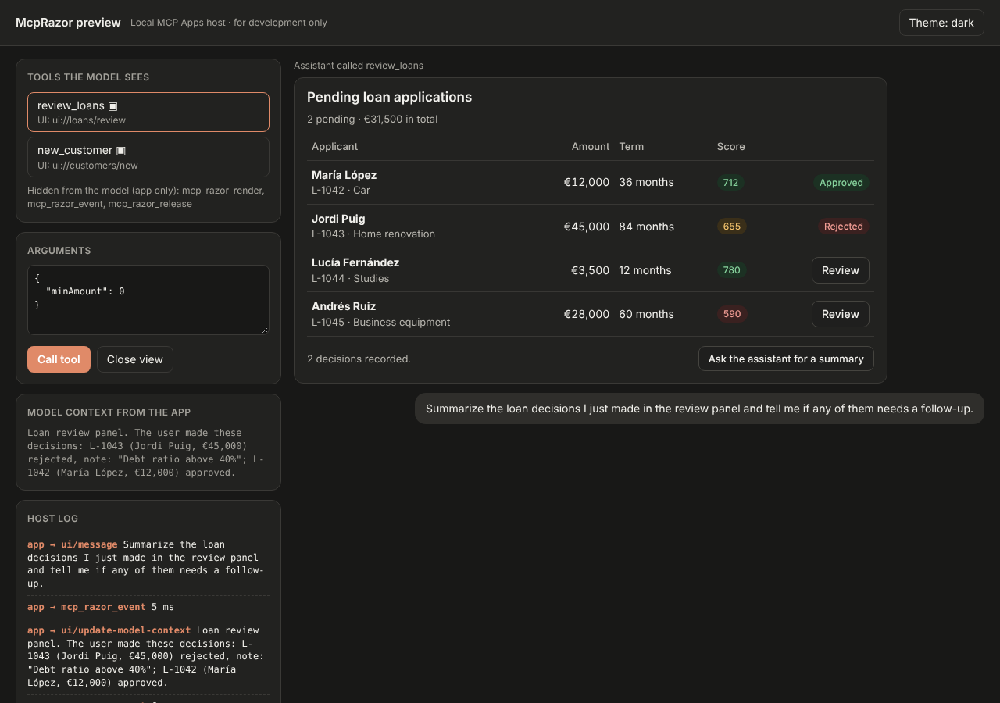
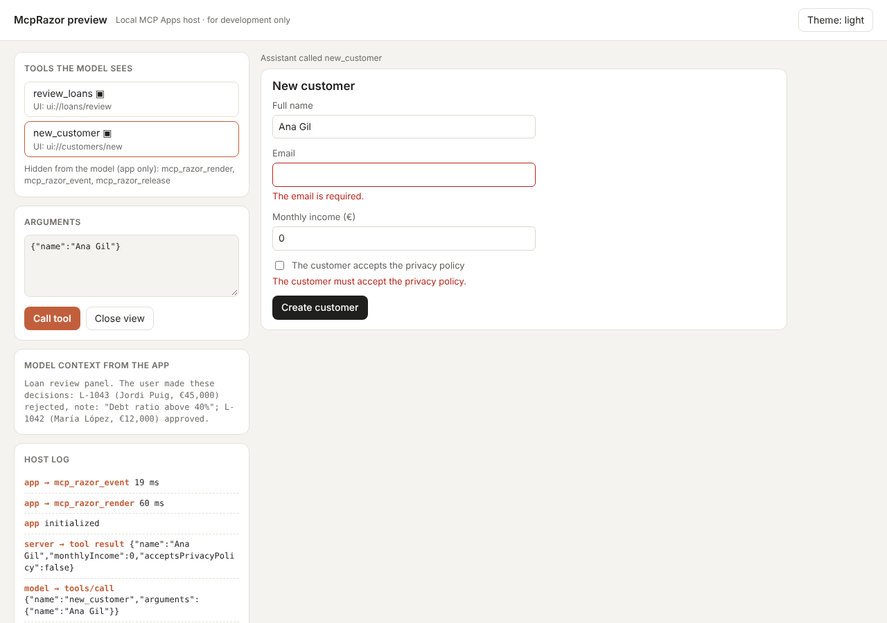

# McpRazor

**Build MCP Apps with Razor components.** Write the interactive UI that Claude, VS Code and other MCP hosts show
inside the chat as ordinary `.razor` files, with `@onclick`, `@bind` and `EditForm`. The components run on your
server; the host only shows HTML and sends back what the user does.



> **Preview.** McpRazor builds on the MCP Apps extension of the official C# SDK, which is still experimental
> (`MCPEXP003`), and on the MCP Apps specification `2026-01-26`. Expect breaking changes before 1.0.

## Why

[MCP Apps](https://modelcontextprotocol.io/extensions/apps/overview) let a tool return an interactive UI that the
host renders in a sandboxed iframe in the conversation. The official SDK takes care of the protocol metadata, but the
UI itself is still hand-written HTML and JavaScript that talks to the host over `postMessage`.

McpRazor lets a .NET team write that UI in C#:

- **Razor components, not a separate front end.** Data binding, validation with `DataAnnotations`, child components,
  dependency injection and async lifecycle methods work as they do in Blazor.
- **Your server keeps the logic.** Event handlers run on the server with your services, your authorization and your
  database. Nothing but HTML reaches the browser.
- **One package, no front-end build.** No WebAssembly, no npm, no bundler. The app shell, runtime included, is about 20 KB.
- **Talks to the model.** A component can update the model's context with what the user did, or post a message to
  the chat.

## Install

```bash
dotnet add package McpRazor --prerelease
```

Requires .NET 10 and the ASP.NET Core shared framework (the components run on the Blazor renderer).

## Quick start

**1. A tool that returns structured content and points to a UI.**

```csharp
[McpServerToolType]
public sealed class LoanTools(LoanService loans)
{
    [McpServerTool(Name = "review_loans", UseStructuredContent = true)]
    [McpAppUi(ResourceUri = "ui://loans/review")]
    [Description("Shows the pending loan applications so the user can approve or reject them.")]
    public LoanQueue ReviewLoans() => new(loans.Pending());
}
```

**2. A Razor component for that URI.** `Data` receives the tool's `structuredContent`.

```razor
@attribute [McpApp("ui://loans/review", Name = "Loan review")]
@inherits McpAppComponent<LoanQueue>
@inject LoanService Loans

@foreach (var loan in Data.Loans)
{
    <p>
        @loan.Applicant · @loan.Amount.ToString("C0")
        <button @onclick="() => Approve(loan)">Approve</button>
    </p>
}

@code {
    private void Approve(LoanApplication loan)
    {
        Loans.Approve(loan.Id);
        Host.UpdateModelContext($"The user approved loan {loan.Id}.");
    }
}
```

**3. Register the apps on the MCP server.**

```csharp
builder.Services.AddMcpServer()
    .WithHttpTransport()                 // or .WithStdioServerTransport()
    .WithTools<LoanTools>()
    .WithRazorApps(apps => apps.AddAppsFromAssembly(typeof(Program).Assembly));

var app = builder.Build();
app.MapMcp("/mcp");

if (app.Environment.IsDevelopment())
{
    app.MapMcpRazorPreview("/preview", mcpPath: "/mcp");   // a local MCP Apps host to try it
}
```

In a web project, add `<RequiresAspNetWebAssets>false</RequiresAspNetWebAssets>` to the `.csproj`: the Blazor browser
scripts are not used.

## Try it

The [`samples/LoanReview`](samples/LoanReview) server has two apps: a loan review queue (approve or reject, with a
note) and a customer form with `EditForm` validation.

```bash
cd samples/LoanReview
dotnet run                 # http://localhost:5180/preview
```

The preview page is a small MCP Apps host for development. It connects to `/mcp`, lists the tools the model would see,
calls one, and shows its app in a sandboxed iframe with the restrictive default CSP of the specification. It also shows
what the app sends to the host: messages to the chat and updates to the model context.



To use it from a real host, build the sample and run its DLL over stdio. Do not use `dotnet run` here: it writes
build output to stdout, which breaks the stdio channel. For example, in Claude Desktop's `claude_desktop_config.json`:

```bash
dotnet build samples/LoanReview
```

```json
{
  "mcpServers": {
    "loan-review": {
      "command": "dotnet",
      "args": ["/path/to/mcp-razor/samples/LoanReview/bin/Debug/net10.0/LoanReview.dll", "--stdio"]
    }
  }
}
```

## How it works

```
Model ──tools/call review_loans──▶ Host ──────────────────────────▶ MCP server
                                    │ resources/read ui://loans/review  (static shell + runtime)
                                    ▼
                              iframe (sandbox)
                     ui/initialize · tool-input · tool-result
                                    │
       tools/call mcp_razor_render  │  data = structuredContent
       ────────────────────────────▶│──▶ Blazor renderer on the server: creates the view,
       ◀──────── HTML + viewId ─────│◀── renders the component, returns HTML
                                    │
   click ─▶ tools/call mcp_razor_event (viewId, handler id, value)
       ────────────────────────────▶│──▶ runs the @onclick handler, renders again
       ◀── HTML + host requests ────│◀── (update model context, message, link…)
```

1. **A static shell.** Each app is a `ui://` resource with the same HTML on every read, so hosts can prefetch and
   cache it. It contains base styles that follow the host's theme variables and a small runtime (about 16 KB, no dependencies) that
   speaks the MCP Apps protocol.
2. **Server-side rendering with live components.** When the model calls a tool that points to an app, McpRazor
   creates a view: a component instance with its own DI scope, rendered by a Blazor renderer that keeps the event
   handler IDs of the render tree. The HTML carries them as `data-mcp-on-click="7"`. The first render travels in the
   tool result's `_meta`, so the app shows it with no extra round trip; if it is missing, the runtime asks for it with
   the app-only tool `mcp_razor_render`.
3. **Events are tool calls.** A click, a change or a form submission becomes a call to `mcp_razor_event`. The handler
   runs on the server, the component renders again, and the runtime patches the DOM, keeping focus and what the user
   is typing.
4. **Requests to the host** queued by the component (`Host.UpdateModelContext`, `Host.SendMessage`…) travel back with
   the HTML, and the runtime sends them to the host.

The three internal tools are marked `visibility: ["app"]`, so hosts hide them from the model.

## What a component can ask the host

`McpAppComponent<TData>` exposes `Host` (`IMcpAppHost`); other components can `@inject IMcpAppHost`.

| Member | MCP Apps message | Use |
|---|---|---|
| `Host.Context` | `hostContext` | Theme, locale, time zone, display mode and platform of the host |
| `Host.ToolInput` | `ui/notifications/tool-input` | The arguments of the tool call |
| `Host.UpdateModelContext(text, json?)` | `ui/update-model-context` | Tell the model what the user did, for its next turns |
| `Host.SendMessage(text)` | `ui/message` | Post a message to the chat as the user |
| `Host.OpenLink(url)` | `ui/open-link` | Open an http(s) URL |
| `Host.RequestDisplayMode(mode)` | `ui/request-display-mode` | `inline`, `fullscreen` or `pip` |

The host decides what to do with each request and may ask the user first.

## Options

```csharp
.WithRazorApps(apps =>
{
    apps.AddAppsFromAssembly(typeof(Program).Assembly);     // components with [McpApp]
    apps.AddApp<Dashboard>("ui://sales/dashboard", app =>
    {
        app.PrefersBorder = true;
        app.Stylesheet = ".kpi { font-size: 2rem }";
        app.Csp = new() { ResourceDomains = ["https://cdn.example.com"] };
    });
    apps.ViewIdleTimeout = TimeSpan.FromMinutes(30);         // release views without events
    apps.MaxViews = 500;                                     // least recently used views go first
    apps.DetailedErrors = false;                             // keep exception messages on the server
});
```

## Supported today

- `@onclick`, `@onchange`, `@oninput`, keyboard and focus events, `@bind` (inputs, checkboxes, `textarea`, `select`),
  `@bind:event`, `@onclick:preventDefault` / `stopPropagation`.
- `EditForm`, `DataAnnotationsValidator`, `ValidationMessage`, `InputText`, `InputNumber`, `InputCheckbox` and the
  other built-in inputs.
- Child components, `[Inject]`, `[Parameter]`, `OnInitializedAsync` and async event handlers.
- `<style>` blocks inside components and an app-wide `Stylesheet`.

## Not supported (yet)

- **JavaScript interop** (`IJSRuntime`) and component libraries that depend on it, such as MudBlazor or Radzen.
- **Updates the user did not trigger.** A component cannot re-render on a timer or a background event: the view
  changes only in response to an event.
- **CSS isolation** (`.razor.css` files). Use a `<style>` block or `McpAppRegistration.Stylesheet`.
- **Scripts inside components.** `<script>` tags in component markup are not executed.
- Only the closest element with a handler receives an event; a click is not bubbled to every ancestor handler as in
  Blazor.

## Security

- **App-only does not mean trusted.** `visibility: ["app"]` is enforced by the host, not by the server. McpRazor treats
  every call to its tools as untrusted input: view IDs are random 144-bit values, a view only accepts event handler
  IDs that appear in the HTML it last sent, and errors are generic unless `DetailedErrors` is on.
- **Views are tied to the MCP session** when the transport has one. Over a stateless transport they are only
  protected by their random ID: bind your own authorization to the data the handlers touch.
- **Authorize in the handlers.** A handler runs with your services, so check permissions there as in any API. Use
  your existing approval flows for destructive actions.
- **Text is HTML-encoded** like in Blazor. `MarkupString` is written as is: never build one from user input.
- **No external requests by default.** Hosts apply a restrictive CSP. Declare origins in `Csp` only when the app needs
  them.

## Limits to keep in mind

- **State lives in memory.** Views are kept per server instance. With several instances behind a load balancer, use
  session affinity. A stateless mode is on the roadmap.
- **Each interaction is a round trip** through the host to your server. That suits forms, tables and approvals; it
  does not suit drag and drop or animations.
- **Host support varies.** MCP Apps is new and hosts implement it at different speeds. Some hosts, such as agent
  sessions in Claude Desktop, show the app but do not forward its tool calls: the first view appears, and events show
  an error. Test in the hosts your users have; `/preview?blockAppTools=1` simulates such a host.

## Roadmap

- A stateless mode with signed state, for servers without session affinity.
- CSS isolation from `.razor.css` files.
- A Roslyn analyzer: tool `ResourceUri` without an app, or data types that do not match.
- Testing helpers to render an app and fire events without a host.

## License

MIT
